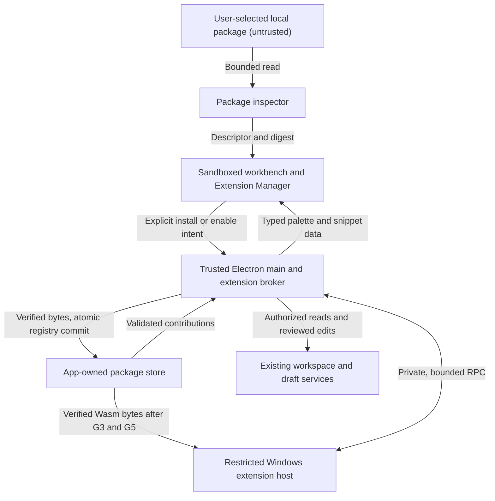

# Phase 4 G0 — Architecture and threat model

**Review status** · Ready for owner review. G0 remains in progress until signoff.

**Baseline** · `f2048ffda5a02e21acfe8d6d39632070c5557961`. This design derives from the Phase 4 Extensibility package and the CEVRA code at that revision. [Phase 3 Windows reliability run](https://github.com/sadatyousufzaisky-commits/cevra/actions/runs/42784806345)

## Scope and protected assets

Start with a local, data-only extension format for snippets and theme palettes. Inspection returns a bounded descriptor and a fingerprint for review. Later gates add an app-owned store, explicit enablement, safe start, and removal. The default with zero extensions supports every existing CEVRA workflow. Executable extension activation is off by default and requires G3 isolation, G5 broker verification, and explicit user enablement.

Protect project files, unsaved drafts, credentials and future provider keys, Git and terminal state, renderer integrity, editor responsiveness, and the integrity of package and consent records. Treat package contents, updates, workspace data, and host messages as untrusted. Account for malicious publishers, compromised distribution, bugs, and interrupted operations. A compromised OS or an attacker who already controls the user's desktop account is outside this model.

## Trust boundaries and data flow

| Boundary | Enforcement |
| --- | --- |
| Package → inspector | Parse as bounded, inert data. Reject ambiguous or unsupported input before offering installation. No hooks or extraction during inspection. |
| Workbench → Electron main | Use enumerated manager intents on the existing preload bridge. Validate the current top-level workbench sender, workspace, action, and payload in main. Obtain sensitive consent in trusted UI. |
| Store → contribution registry | Recheck the installed digest and enabled state before registering contributions. The renderer receives palette values and snippet text through typed adapters, using existing editor rendering. Inserting a snippet is an explicit editor action. |
| Store → executable host | Start only a confined host. Deliver verified module bytes over its private channel after isolation succeeds. The host receives no workspace root, Electron bridge, credential store handle, or project environment. |
| Host → broker → workspace | Authenticate the host by its channel. Authorize each call by capability, scope, and current epoch before accessing existing workspace services. Recheck after asynchronous reads and before returning data or applying an edit. |

### Integration with the Phase 3 baseline

- [`src/main.cjs`](../../src/main.cjs) and [`src/preload.cjs`](../../src/preload.cjs) already restrict workbench IPC to named operations from the correct top-level frame. Preserve those checks, renderer isolation, and the [content security policy](../../src/index.html). The host has its own protocol and transport.
- [`src/workspace.cjs`](../../src/workspace.cjs) owns checked relative paths, workspace root identity, and revision-checked saves. Use those services behind the broker. Reuse the workbench's reviewed edits and [`src/drafts.cjs`](../../src/drafts.cjs) for unsaved changes.
- [`src/preferences.cjs`](../../src/preferences.cjs) keeps workspace execution trust tied to a directory identity. Extension grants use a separate versioned store under app data. Trusting a workspace permits the broker to evaluate an extension request there. The extension still needs its own grant.
- [`src/execution/sessions.cjs`](../../src/execution/sessions.cjs) is a reference for cancellation and stale-owner handling. Use a separate host supervisor so extension failure and teardown are independent of the project runner and terminal sessions.

## Lifecycle and authority

1. **Inspect.** The user selects a local package. Return its canonical inventory, compatibility, declared contributions, and SHA-256 of the reviewed archive bytes. Publisher identity remains unverified unless there is a separately verified publisher identity. A digest establishes byte integrity.
2. **Install disabled.** Reopen and verify the approved digest and inventory, stage app-owned copies, then atomically commit the registry pointer to an immutable digest. Interrupted transactions recover to either the previous committed generation or the new complete one. Opening a workspace starts no extension code.
3. **Enable explicitly.** A profile or workspace preference may enable inert contributions. Executable activation requires a separate explicit action and a current, verified host. The effective runtime state progresses from starting to active only after a valid handshake.
4. **Suspend and revoke.** First advance the session epoch and refuse new calls. Cancel outstanding requests, discard late responses, remove registrations, and stop the affected host. Workspace switch, directory replacement, or trust revocation invalidates the previous workspace scope. Renderer loss or app exit tears down active hosts. Restore the workbench and drafts through their existing recovery path.
5. **Fail and quarantine.** Record a bounded failure category and leave the workbench usable. A protocol violation disconnects the host. Repeated crashes quarantine the package and require an explicit recovery action. A failed teardown is visible and blocks reactivation until the supervisor confirms the old host exited.
6. **Update or remove.** A new digest requires review even if the version label and requested capabilities match. Updates begin disabled and keep a rollback candidate. Rollback restores package bytes and a disabled state. Uninstall removes registrations, grants, and the registry entry after host teardown. A safe-start mode suppresses all extension contributions and host launches while allowing management.

Store installed version and digest separately from the enablement preference and live session state. A package can remain installed and enabled while suspended. Only an active session may call the broker. Keep durable consent, if offered, separate from the session grant. Mint session grants from current consent after explicit activation.

A session grant binds extension ID, exact digest, verified workspace directory identity, opaque workspace session, capability, narrow scope, authenticated host instance, and current epoch. Treat request IDs as correlation only. Revocation invalidates pending and future results. For an edit, a final grant and source-revision check immediately precedes the authorized commit point. Once an approved commit has completed, use the ordinary editor undo or recovery flow.

## Capability map

| Capability | Scope and enforcement |
| --- | --- |
| Declarative snippets and themes | No runtime grants. Accept bounded snippet text and palette keys with literal color values. Reject script, arbitrary CSS, and rich markup. Register per extension digest and remove on disable. |
| `commands.register` | Namespaced, bounded registrations owned by the current activation. A command invocation goes through its normal broker checks. |
| `diagnostics.publish` | Publish bounded, sanitized messages for authorized documents. Match each to a source revision and discard stale results. |
| `editor.readSelection` | Explicit consent for bounded selection text in the active workspace. Check the editor and revision on delivery. |
| `workspace.read` | Explicit consent for named file or directory scope. Issue revocable file handles, recheck path and workspace identity, and return the revision. Read saved files by default. Draft access requires separate scope and marks the result as a draft. |
| `editor.proposeEdit` | A scoped proposal includes its expected source revision. The workbench displays a diff and requests acceptance. The trusted editor service checks the exact revision before applying. |
| `network.request` | Reserved. Denied in the initial executable API. Any future network broker needs its own review, destination policy, consent, and tests. |

Shell, Git writes, credential access, arbitrary filesystem access, native module loading, clipboard access, and arbitrary renderer access have no Phase 4 broker method. Audit records carry operation, extension ID/version, digest prefix, hashed workspace identity, result, duration, and bounded error category. Source text, raw workspace paths, tokens, and arbitrary host output stay out of the audit record.

## Windows host decision for G3

Prototype a dedicated Wasmtime host inside a Windows **Less Privileged AppContainer (LPAC)**. Wasm modules receive a small versioned CEVRA import surface and no WASI imports. Use Wasmtime for guest memory, imported calls, fuel, and memory limits. Bound module compilation separately and enforce an independent supervisor deadline. Accept portable Wasm bytecode. The host compiles it inside confinement. [Wasmtime security model](https://docs.wasmtime.dev/security.html) · [Wasmtime interruption and resource limits](https://docs.wasmtime.dev/api/wasmtime/struct.Config.html)

The prototype must start with zero optional AppContainer capabilities and no access to the workspace, CEVRA app data, clipboard, or network. Use an explicit minimal environment, a host-only working directory, and allowlisted private transport handles. Block child process creation and assign the host to a non-inheritable job before delivering module bytes. The job owns resource limits and process teardown. The AppContainer and narrow imports own access confinement. Verify both the guest-facing API and the Windows process boundary independently with disposable fixtures. [Microsoft AppContainer launch](https://learn.microsoft.com/en-us/windows/win32/secauthz/implementing-an-appcontainer) · [Handle inheritance](https://learn.microsoft.com/en-us/windows/win32/procthread/inheritance) · [Job objects](https://learn.microsoft.com/en-us/windows/win32/procthread/job-objects)

Use a per-instance private channel, fixed protocol version, bounded length framing, at most 256 KiB per request and 1 MiB per response, and narrower method budgets. Apply a finite in-flight queue, deadlines, and heartbeat. Reject unknown methods and malformed messages. A launch that cannot establish the required confinement or job membership fails before receiving the module. Existing Node child processes, `vm`, and worker threads do not qualify as the executable security boundary.

The runtime choice is a G3 prototype decision. Test the launcher, runtime, denied operations, cleanup, and failure behavior on each Windows version for which executable support will be claimed. Record the OS build and runtime version for each result. If G3 cannot show confinement or G5 cannot show authorization, keep executable activation blocked. Escalate the gap to the owner for a runtime change or an explicit declarative-only scope decision.

## Version and failure rules

- Keep manifest schema, app compatibility, executable API, and wire protocol independently versioned. Manifest v1 is declarative only. Use lowercase reverse-domain extension IDs and core three-part package versions. G1 will freeze the bounded engine-range grammar and exact archive layout before treating packages as installable.
- Reject unknown fields and incompatible versions with an actionable reason. Only negotiate explicitly supported executable APIs before activation. Package IDs and API contracts stay stable through the Phase 6 product rename.
- Bind the review to the exact archive digest. Record per-entry digests in the inventory for later extraction and store verification. A change to either the bytes or the requested authority requires a new review.
- Use stable error categories for incompatibility, denied capability, stale grant or revision, protocol violation, quota, and host failure. A failed action leaves the previous committed version available and never retries with broader authority.

## Threat scenarios and acceptance tests

These are test specifications for the indicated gates. Use disposable packages, projects, profiles, and hosts. Compare workspace bytes, broker call counts, registry state, and host liveness as applicable. Record the gate commit, test output, reviewer, toolchain, and Windows build with each result.

| Case | Gate | Fixture and action | Pass assertion |
| --- | --- | --- | --- |
| EXT-01 · Benign reference packages | G1 | Inspect one snippet-only and one theme-only archive twice. | Both produce stable descriptors and digests. Workspace and package store remain untouched. |
| EXT-02 · Auto-activation and package hooks | G1, G4 | Open a workspace containing a package candidate. Explicitly inspect a fixture declaring unsupported execution fields. | Opening triggers no extension execution. Inspection rejects the fields and launches no process. |
| EXT-03 · Ambiguous or incompatible manifest | G1 | Use fixtures with duplicate keys, unknown fields, unsupported schema, or out-of-range engine. | Each produces an explicit rejection. No install or activation is offered. |
| EXT-04 · Unsafe paths and links | G1, G2 | Present fixtures with non-canonical paths, Windows name collisions, or link entries. | Validation rejects them. A sentinel outside the staging root remains intact. |
| EXT-05 · Input budget | G1 | Inspect a fixture exceeding an archive, manifest, or decompression limit. | The scan stops within its configured budget and produces no package files. |
| EXT-06 · Package changes after review | G2, G7 | Replace reviewed bytes before install or change an installed package before enablement. | Digest mismatch prevents installation or activation. The old committed generation stays available. |
| EXT-07 · Interrupted install and update | G2, G7 | Interrupt the install at each durable-write and registry-commit checkpoint. Restart. | The registry points to either the prior valid digest or the complete new digest. No partial registration or grant appears. |
| EXT-08 · Guest and OS confinement | G3 | Under disposable host and workspace profiles, check synthetic private files, environment and clipboard sentinels, native process and handle facilities, and controlled loopback and non-loopback listeners. | Guest imports offer no ambient access. The restricted host cannot access the private test assets or reach either listener. No extra process or inherited privileged handle is present. |
| EXT-09 · Host lifetime and budgets | G3 | Use a controlled host that stalls or crosses a configured memory, output, or request limit. Stop it or close the supervising app. | The supervisor reports the bounded fault, reaps the host, and the workbench remains responsive. |
| EXT-10 · Crash during an edit | G3, G6 | Back up an unsaved edit and induce a host failure. Repeat until quarantine. Restart CEVRA. | The latest backed-up draft remains recoverable. Registrations disappear and the quarantined host stays stopped. |
| EXT-11 · Grant scope and replay | G5 | Deny a capability, then exercise a granted scope and try the old handle after workspace switch, replacement, or restart. | Denied, cross-scope, and stale calls return no data. Authorized in-scope calls return only bounded, revision-tagged data. |
| EXT-12 · Revoke while a request is pending | G5 | Hold a read or proposal open, revoke permission, then release the pending result. | The broker discards the late result, and no edit, data delivery, or new call succeeds. Host and registrations are removed. |
| EXT-13 · Stale proposal | G4, G5 | Review a proposal, then edit the draft or change the saved file before approval. | The exact-revision check rejects the proposal without overwriting either version. |
| EXT-14 · Digest and publisher changes | G5, G7 | Review a same-ID update with changed bytes or capabilities, then try to reuse its prior approval. | The package requires fresh review and grants. Self-reported publisher metadata confers no authority. |
| EXT-15 · Inert contribution lifecycle | G4, G6 | Enable and disable a declarative theme and snippet, then start in safe mode. | Only supported data reaches the editor. Disable and safe mode leave no registrations or host processes. |
| EXT-16 · Audit privacy | G5 | Allow and deny calls using synthetic paths, source and credential markers. Inspect persisted logs. | Correlation metadata remains useful while all sentinel values are absent. |
| EXT-17 · Core regression and latency | G9 | Run the existing Continuum desktop flow with zero extensions and with declarative extensions installed. Benchmark the zero-extension path on the same machine and fixture as Phase 3. | Windows regressions pass. Publish matched p50/p95 timings, test counts and any unresolved regression. |

## Review and next gate

Review the executable host decision, capability map, lifecycle and acceptance tests together. A critical unresolved threat blocks the affected feature and gate. Keep the status ledger in progress until owner signoff and track any required change against its test case.

The next implementation slice is G1's read-only inspector. Freeze the v1 archive and compatibility grammar, accept the two inert fixtures, and reject malformed packages before adding storage, preload wiring, or activation.
