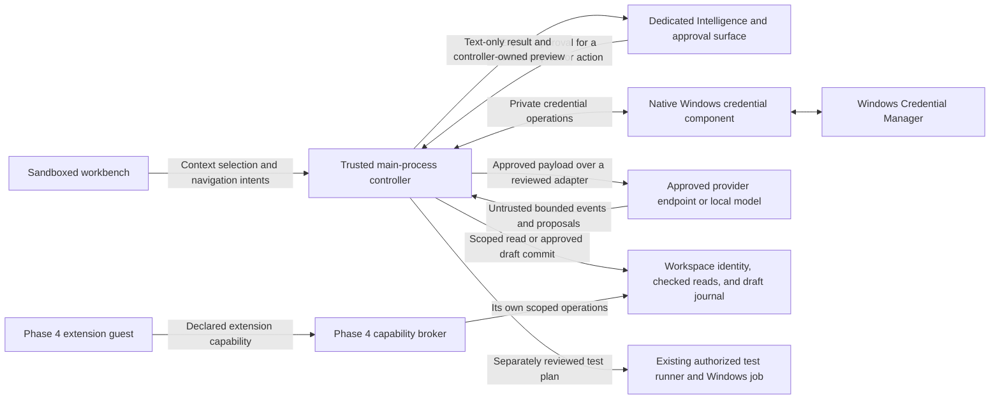

# Phase 5 G0 — Intelligence architecture and threat model

**Status** · G0 design signed off on 2026-11-12. The project owner directed proceeding with the next build after the design was presented for signoff. **Baseline** · Phase 4 completion `4960ef251237583f9ee7a21e067f949dd2f6d4b0` on `cevra/phase4-g3`. The Phase 5 development branch starts from that revision. All ten Phase 4 gates have passed, including the confined host, capability broker, and Windows integration. [Phase 4 ledger](../phase-4/PHASE4_STATUS.json)

## Product scope

Intelligence is optional and off by default. Users choose a provider and model and authorize use of their own provider account or a local model. CEVRA stays free and works offline with Intelligence disabled, including editing, extensions, Git, the terminal, debugger, and test runner. Provider billing applies to the user's account. CEVRA's scope excludes a hosted inference relay, account scraping, credit resale, automatic repository uploads, and unrestricted model-controlled tools. Phase 6 owns branding.

The first useful slice is prompt-only conversation with a deterministic mock. The complete Windows journey connects an authorized provider, previews the exact selected code and destination, explains a failing test with revision-bound source references, proposes an edit, applies the reviewed diff as drafts, and runs tests under a separate approval. The user can stop or disconnect at each boundary. The result identifies what the runner observed and distinguishes it from model output.

## Architecture

The controller owns requests, connection state, approval records, revocation epochs, quotas, and normalized provider events. Main validates the originating top-level frame and then checks the request's current owner, workspace, scope, and approval. Sender validation alone establishes which surface sent an IPC message. An ordinary workbench event supplies a selection or navigation intent only.

Use a main-owned Intelligence surface with its own sandboxed web contents and a minimal preload. Main associates this surface with the current editor window and workspace. It supplies the canonical preview and accepts **Send**, **Apply as Drafts**, or **Run Tests** only from the expected approval surface for that exact pending item. Prompt-only requests can be composed and sent there directly. The workbench and extension bridge have no approval endpoint. The review surface renders model content and context as text with fixed local UI and no external resource loads. Use a native credential dialog for secret entry. Rendered content carries no approval authority.

### Reuse the verified boundaries

| Current CEVRA boundary | Phase 5 integration |
| --- | --- |
| Main checks the workbench sender and top-level frame. The sandboxed renderer has context isolation, a named preload bridge, and a restrictive content security policy. [Main](../../src/main.cjs) · [Preload](../../src/preload.cjs) · [CSP](../../src/index.html) | Add a separate sender check and narrow IPC for the Intelligence surface. Main owns authority and reports bounded, sanitized status. No credential getter or general transport call belongs in either preload. |
| Workspace reads check root identity, canonical paths, file identity, and disk revisions. Preferences bind workspace trust to directory identity. [Workspace](../../src/workspace.cjs) · [Preferences](../../src/preferences.cjs) | Reuse these checks with AI-specific content policy and approval. Treat execution trust and permission to disclose source as independent grants. |
| Edit preview and stage-edits verify revisions and the draft store commits a batch through a recovery journal. [Edit preview](../../src/edit-preview.js) · [Main](../../src/main.cjs) · [Drafts](../../src/drafts.cjs) | G5 adds a first-party proposal authority and verifies the exact reviewed batch at the journal commit boundary. Ordinary editor Save remains the disk write path. |
| Execution uses workspace-bound authorization, supervised sessions, and process-tree cleanup. Existing recipe authorization can request confirmation even in a trusted workspace. [Main](../../src/main.cjs) · [Sessions](../../src/execution/sessions.cjs) · [Process host](../../src/execution/process-host.cjs) | G6 uses a typed test plan and an explicit confirmation even when the workspace is trusted. The controller associates the existing runner session with the approved AI task and stops that owned session on cancellation. |
| The Phase 4 broker grants scoped capabilities to the exact extension digest and workspace. It removes commands, diagnostics, and proposals on revocation. [Extension broker](../../src/extensions/broker.cjs) · [Phase 4 Windows evidence](../phase-4/g9-final-integration.md) | Intelligence and extensions keep separate authority. Both use checked workspace services. Extension grants convey no AI access, and an Intelligence approval conveys no extension capability. |

## Decisions for implementation

| Decision | G0 design |
| --- | --- |
| Credentials | Prefer a small trusted native Windows component and per-user generic Credential Manager entries with local-machine persistence. Use an opaque, random target identifier in a stable CEVRA namespace. Native entry and vault access stay outside the workbench. If main and the component communicate across processes, use a bounded private channel with explicit handle inheritance. Store only connection metadata and the opaque reference in preferences. [Credential structure and persistence](https://learn.microsoft.com/en-us/windows/win32/api/wincred/ns-wincred-credentialw) · [Credential write scope](https://learn.microsoft.com/en-us/windows/win32/api/wincred/nf-wincred-credwritew) |
| Provider adapters | Use a built-in registry of first-party adapters with a versioned stream and capability contract. The registry exposes metadata and provenance. Credentials are resolved by the trusted controller for an approved request, used for its destination, and released promptly. G1 begins with the deterministic mock and checks schema, usage, errors, completion, and cancellation. |
| Account authorization | Start with user-created API credentials for the first reviewed cloud adapter. OpenAI, Anthropic, and Gemini are candidates. Each live adapter needs a dated review of current official API documentation and permitted use, allowed origins, authentication scope, billing and retention disclosures, and cancel/retry semantics. A subscription-linked adapter needs provider-documented third-party desktop eligibility, a registered application where required, restricted scopes, and verified expiry and revoke behavior before it can appear in the picker. |
| Local models | G7's first candidate is a user-run Ollama service with an installed local model. Limit the adapter to fixed inference and discovery routes on an explicitly approved numeric loopback address and port. Check the actual peer and block redirects and proxy routing. Require a verified local-only service configuration and an offline test before labeling the adapter offline. A loopback address alone gives no assurance about the service's onward traffic. CEVRA leaves service lifecycle and model downloads to the user. [Ollama local API](https://docs.ollama.com/api/introduction) · [Ollama local-only mode](https://docs.ollama.com/faq#how-do-i-disable-ollamas-cloud-features) |
| Personalization | Keep user language, style, test, and model preferences as nonsecret local settings. G4 may include explicitly selected project guidance such as `.cevra/ai-instructions.md` in the context preview. Treat it as repository data with no ability to change policy or grant access. |
| Agent tools | Start with selected text and approved read-only context, then typed edit and test proposals. Require distinct approval for outbound context, applying an exact patch, and executing a test plan. Bound steps, time, bytes, and spend admission. Exclude arbitrary shell, network, Git mutations, and dependency installation from the Phase 5 agent tool set. |
| Retention | Keep prompts, context, responses, and approvals in memory for the active workspace session by default. Clear session data on switch, disable, or close. Optional local history needs scoped retention and deletion tests before enablement. Keep a bounded local ledger of outcomes and usage metadata with no raw prompts, source, credentials, or provider headers. |
| Extension interface | Keep the first Intelligence release first-party. Phase 4 extension guests have no connection, credential, provider request, or Intelligence tool API. A future contribution contract needs its own boundary review and explicit scope. |

### Credentials and provider traffic

The controller tracks a connection ID and credential generation. Provisioning, rotating, or deleting credentials is user-initiated. Rotation invalidates the old generation and cancels its outstanding work before the replacement is usable. Disconnect disables the connection, invalidates authority, aborts owned operations, persists the disabled state, and deletes the vault entry. Confirm success after the disabled state is durable and vault deletion succeeds. A deletion failure leaves the connection disabled with an actionable cleanup state. At startup, incomplete provisioning or rotation stays unusable until recovered explicitly. No interrupted paid request resumes on startup. Provider-side key revocation is separate from local deletion.

Permit only the adapter's reviewed HTTPS origin and routes, validated TLS, and bounded requests with deadlines. Block redirects before forwarding authorization or payload. Model-supplied URLs and provider response links are data. Connection checks require an explicit action and disclose that the provider may charge for the check. Keep secrets out of process arguments, environment variables, editor IPC, logs, crash reports, and application preferences. Test Windows account separation, rotation, restart, deletion, and failure states using synthetic credentials before enabling live traffic.

### Context, approvals, and lifecycle

1. **Prepare.** Prompt-only is the default. Main resolves selected paths inside the current workspace, applies the AI exclusions for secrets and unsupported files, and bounds bytes and file count. Draft context includes the editor document version and verified disk base revision. The controller constructs the exact text to send and assigns revision-bound source references.
2. **Preview and send.** Show the destination, model, prompt, exact included source, and any usage estimate. Bind a short-lived, single-use approval to the request, owner surface, workspace identity and epoch, connection generation, provider/model destination, operation, and a digest of the reviewed payload. Recheck trust, revisions, and epochs before the transport sends. Changed content or destination requires a new preview. Provider input contains only the reviewed context and disclosed instruction template.
3. **Receive.** Validate and bound each event, queue, and total response. Allow one current stream per workspace in the first slice. Reject stale or out-of-order events after cancellation or completion. Preserve source attribution only for references the controller issued, with historical status when the underlying revision changes. Provider usage and cost are estimates with provenance. Unknown prices stay unknown.
4. **Propose and review.** Model output can propose typed changes to an authorized scope. Main binds the diff, file identities, original revisions, and draft versions to a one-time approval. G5 serializes final admission against revocation at the draft journal commit boundary. A stale batch rejects as a unit. A commit admitted before revocation remains an ordinary recoverable draft.
5. **Execute separately.** The test plan names the workspace, reviewed operation and target, and input revisions. The approval states that workspace tests run with the user's Windows permissions. Recheck the plan after the user's separate approval and use the existing supervised runner. Review any save required before running tests. Report the runner's observed exit and evidence. Test output remains untrusted and requires fresh disclosure approval before a subsequent provider call.
6. **Stop or invalidate.** User stop, workspace switch or trust revocation, owner renderer loss, app close, Intelligence disable, or connection revocation invalidates the affected epoch before asynchronous cleanup. Abort the transport, close pending reviews, discard late responses, stop owned test process trees, and release context and grants. For Stop during an in-flight request, show that bytes already received by a provider and incurred charges are governed by that provider. The editor retains existing recovery drafts and independent user work.

## Threat model and acceptance evidence

Protect credentials, source and unsaved drafts, command and Git authority, workspace separation, and user spend. Treat provider events, model text, project files, test output, and extensions as untrusted. The CEVRA main process, its trusted approval surface, native credential component, and OS facilities form the trusted boundary. A compromised OS or another process with equivalent privileges in the same Windows account is outside the credential-store isolation claim.

| Case | Gate | Evidence to collect |
| --- | --- | --- |
| AI-01 · AI disabled or unconfigured | G1, G3, G9 | Start, open, and switch workspaces with AI off or no connection. No AI sockets, background context collection, or credential prompts. Core and Phase 4 workflows pass. |
| AI-02 · Invalid provider stream | G1, G3 | Deterministic stream and cancel tests plus malformed, oversized, delayed, and duplicate frames. Bounded memory, terminal error or cancellation, and no late UI updates. |
| AI-03 · Credential isolation and rotation | G2, G8 | A synthetic vault secret survives authorized restart and stays absent from renderer, extension, logs, crash artifacts, and preferences. Another Windows account cannot retrieve it. Rotation and delete failure invalidate the old connection. |
| AI-04 · Endpoint and account scope | G2, G7 | Reject an unapproved account flow and a changed or redirected endpoint. No authorization headers or source leave for the denied target. Local fixture rejects a non-loopback peer and works with cloud access disabled. |
| AI-05 · Scope and path denial | G4 | Selected context matches the preview. Deny untrusted workspace reads, excluded files, absolute paths, traversal, symlinks, junctions, and path replacement without disclosing source. |
| AI-06 · Changed preview | G4 | Change disk bytes, draft version, workspace, model, or connection between preview and send. Stale approval yields no outbound payload. |
| AI-07 · Replay or counterfeit approval | G4, G5, G6 | Replay a consumed, expired, wrong-surface, or wrong-operation approval. No outbound call, draft commit, or process launch. |
| AI-08 · Unsafe or stale patch | G5 | Reject out-of-scope paths, replaced files, and changed revisions. A reviewed multi-file patch applies as one journaled draft batch and recovers after interruption. |
| AI-09 · Run authorization | G6 | Prompt or patch approval alone starts zero processes, including in a trusted workspace. A separately approved typed test plan executes through the Windows job. A changed plan or input is refused. |
| AI-10 · Cancellation and isolation | G3, G6, G9 | Cancel during reads, streaming, patch admission, or process launch. Exercise workspace switch, renderer crash, and connection revoke. Check that late results cannot commit or start work and owned child processes exit. |
| AI-11 · Prompt and output injection | G4, G8 | Use synthetic repository, provider, and test-output instructions. They never gain tool authority, send undisclosed content, load external assets, or expose credentials. |
| AI-12 · Routing and cost | G7, G8 | Different provider destinations require explicit approval. Unknown pricing, rate limits, budget exhaustion, and retries produce accurate status and no silent paid retry. |
| AI-13 · Extension boundary | G2, G8, G9 | Exercise active Phase 4 guests with Intelligence enabled and disabled. Guests have no credential, provider, or AI approval access. Extension isolation and lifecycle regressions still pass. |
| AI-14 · Full Windows journey and performance | G9 | Reproduce the consent-to-test workflow and its denial paths in Windows desktop CI. Record baseline revision, hardware, builds, sample count, median and p95 for AI-off editor behavior and bounded streaming. |

The review traced separate approvals for connection use, source disclosure, draft commits, and execution. It checked workspace, owner, and connection changes at each asynchronous boundary. The implementation gates own the Windows vault tests, exact preview and commit races, provider behavior, and CI evidence above.

## Baseline verification

On 2026-11-12, `npm run test:core` passed all 118 tests with Node.js 24.15.0 on Windows 11 x64 build 26300. The run covers existing source revision checks, draft journaling, execution cancellation, and extension isolation policy. The last verified Phase 4 Windows run passed 209 tests across core, desktop, and the actual extension host on Windows Server 2025 x64 build 26100. The current deliverable is the G0 design. The proposed Intelligence behaviors in the table require new evidence in their respective gates. [Verified Phase 4 Windows run](https://github.com/sadatyousufzaisky-commits/cevra/actions/runs/42988060217)

## Gate handoff

The signoff covers the architecture, integration map, provider policy, and threat matrix. G1 uses a built-in mock adapter, strict provider events, cancellation, and no-network tests. G2 then proves credential isolation on Windows before G3 enables a reviewed live adapter. [G1 provider contract](g1-provider-contract.md) · [Phase 5 ledger](PHASE5_STATUS.json)
