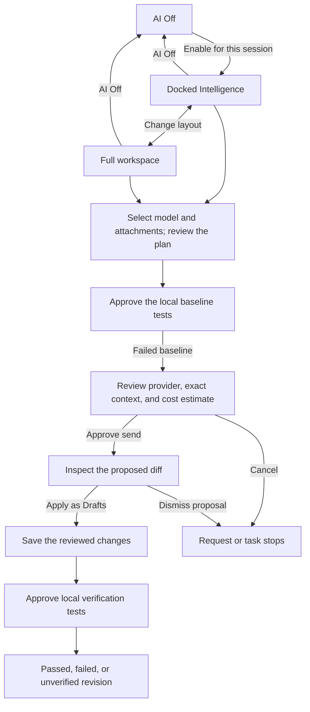

# G8 VOKRI Intelligence workspace

The workbench starts with **AI Off**. Select it to enable Intelligence for the current session. **Intelligence workspace** opens the dock beside the editor. **Full workspace** expands that same view and keeps the prompt, conversation, attachments, and coding-task progress. **Dock** restores the editor. The workbench also offers the separate Intelligence window used in the Phase 5 preview.

The workspace shows whether the selected model uses a cloud API, local Ollama, or the offline simulation. Attachments and model connections stay visible beside the conversation in the full workspace. For a coding task, the plan marks the current step and keeps baseline and verification results next to it. **Stop** stops a stream, and **Stop coding task** cancels the active task. **AI On** turns Intelligence off and clears the open session. Model preferences and credentials remain available for a later session.

## Approval flow

The dock and full workspace display a single sandboxed Electron view. The editor has its own renderer. The main process checks the Intelligence view's exact top-level sender for each request. Editor dialogs take precedence over the Intelligence view, so the diff opens in the existing workbench with its normal revision and permission checks. Workspace change, close, and AI Off retire the active session. [Electron WebContentsView API](https://www.electronjs.org/docs/latest/api/web-contents-view) · [Phase 5 architecture](../phase-5/g0-architecture.md)

| Decision | What the user sees |
| --- | --- |
| Run the baseline | A separate local test approval and a baseline result bound to observed workspace inputs. |
| Send to a provider | The model, cloud or local destination, exact text, output limit, and cost uncertainty. Cancel has initial focus. Switching providers requires a new send review. |
| Apply changes | An editor diff for the exact proposed revision. Apply creates undoable drafts. Save is a separate editor action. |
| Verify saved changes | A separate local test approval and a passing, failing, or unverified result. |

Google Antigravity documents review of planning artifacts and code diffs. The G8 walkthrough uses the repair of one failing test to examine four decision points in VOKRI Code, from baseline approval through the verified result. It records each step in VOKRI Code using a synthetic provider transport and a real local test runner. The Antigravity reference is a documentation comparison. [Google Antigravity artifact review](https://antigravity.google/docs/artifact-review/)

## Optional live provider checks

- **OpenAI**. In a disposable project, add a user-owned API project key under **Provider connections** and select a model. Use a synthetic prompt and file. Verify the endpoint, exact request, and estimated reservation in the review. Cancel first, then approve a request if you want to incur any applicable API charge. Check the usage and disconnect the key when finished.
- **Ollama**. Start a local Ollama service with cloud features disabled and install a model. Discover it through **Models and local connection**. Review a request, confirm the loopback destination, verify that the response streams, and test **Stop**. Disconnect Ollama when finished. [Existing local setup](../phase-5/g7-model-routing-and-offline.md)

## Verification

The Windows desktop suite covers the shared sandboxed view and a complete repair with baseline, exact send review, patch, save, and verification. The Phase 5 tests still cover cancellation, revoked keys, stale context, rejected patches, provider switching, the loopback Ollama fixture, and recovery after restart. The desktop suite uses synthetic cloud transport and does not require a provider account. [Mock and layout regression](../../qa/intelligence-mock-desktop.test.cjs) · [Provider and repair tests](../../qa/intelligence-stream-desktop.test.cjs)
